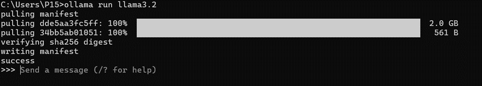
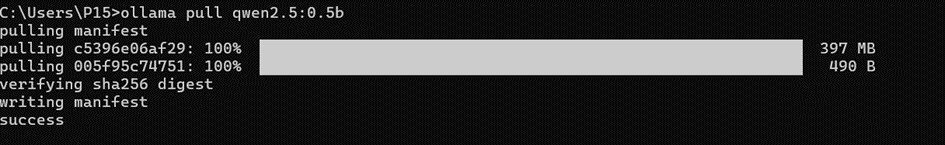
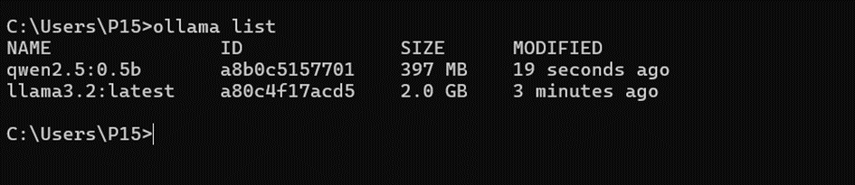
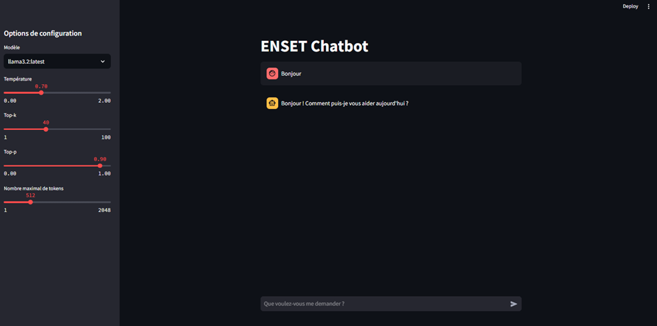
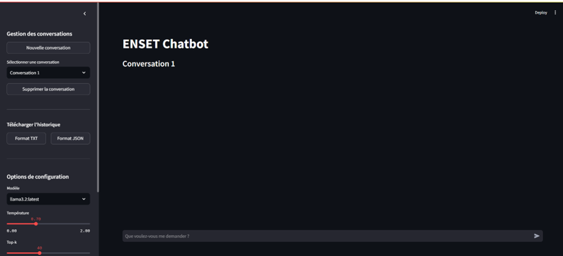
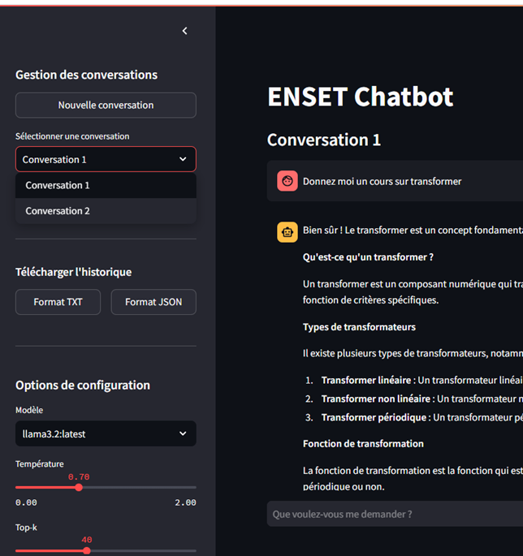
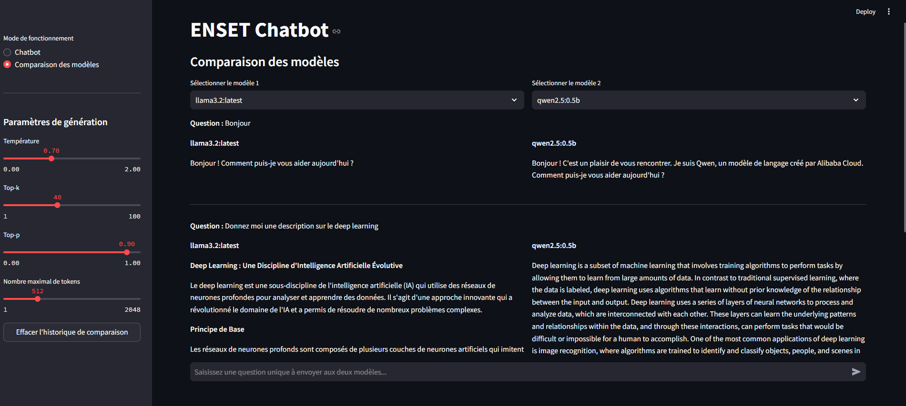
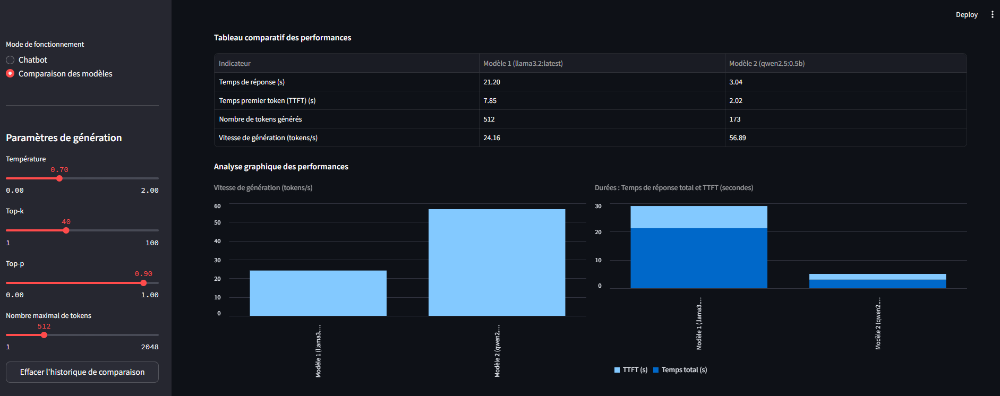
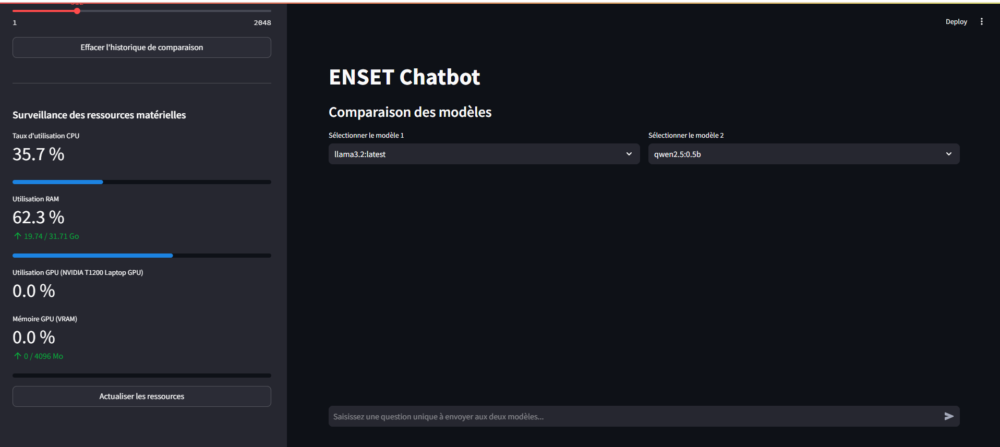
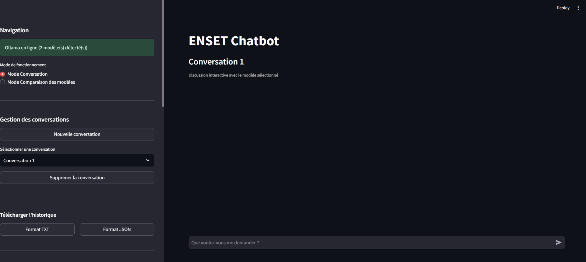

# ENSET Chatbot - Assistant LLM Local

Application Streamlit permettant d'interagir localement avec des modèles de langage via Ollama, d'administrer plusieurs fils de discussion et de comparer les performances des modèles en temps réel.

---

## 1. Installation et préparation des modèles

Les modèles sont exécutés localement avec Ollama. Deux modèles ont été installés pour les tests : Llama 3.2 et Qwen 2.5 (0.5B).

### Téléchargement de Llama 3.2
```bash
ollama run llama3.2
```


### Téléchargement de Qwen 2.5 (0.5B)
```bash
ollama pull qwen2.5:0.5b
```


### Vérification des modèles disponibles
```bash
ollama list
```


---

## 2. Version initiale du chatbot

L'application de départ propose une interface conversationnelle simple reliée à Ollama avec le réglage des paramètres d'inférence (température, top-k, top-p, tokens maximaux).



---

## 3. Amélioration 1 : Gestion avancée des conversations

Cette évolution permet de gérer l'historique complet des échanges au sein d'une même session :
* Création d'une nouvelle discussion via un bouton dédié.
* Conservation et bascule fluide entre plusieurs conversations.
* Suppression de la discussion active.
* Export de l'historique au format TXT ou JSON.





---

## 4. Amélioration 2 : Comparaison de plusieurs modèles

Un mode dédié permet d'envoyer une question unique à deux modèles simultanément. Les deux LLMs répondent côte à côte sous des conditions d'inférence strictement identiques.



---

## 5. Amélioration 3 : Mesure et analyse des performances

Pour chaque réponse produite, des indicateurs précis sont collectés puis restitués sous forme de tableau et de graphiques :
* Temps de réponse global.
* Temps jusqu'au premier token (TTFT).
* Nombre de tokens générés.
* Vitesse de génération en tokens par seconde.



---

## 6. Amélioration 4 : Surveillance des ressources matérielles

L'application intègre un suivi en direct des composants de la machine :
* Taux d'utilisation du processeur (CPU) avec psutil.
* Utilisation de la mémoire vive (RAM).
* Activité du processeur graphique (GPU) et mémoire VRAM via nvidia-smi.



---

## 7. Amélioration 5 : Robustesse et ergonomie

Des mécanismes assurent la stabilité et le confort d'utilisation :
* Détection automatique des modèles réellement installés sur Ollama.
* Alerte explicite en cas de coupure ou d'inaccessibilité du service Ollama.
* Traitement des erreurs d'inférence sans interruption de l'interface.
* Indicateur visuel de chargement lors de la génération.
* Navigation claire pour basculer facilement entre le mode conversation et le mode comparaison.



---

## Architecture de l'application

L'application repose sur une architecture simple autour d'un fichier principal `app.py` :

* **Interface utilisateur (Streamlit) :** gère la barre latérale (navigation, sélection des modèles, paramètres d'inférence, gestion des conversations) et la zone principale (chat ou comparaison côte à côte).
* **Gestion d'état (`st.session_state`) :** conserve les conversations actives, leur historique et les résultats de comparaison durant la session.
* **Client LLM local (`ollama`) :** vérifie la disponibilité du service Ollama (`ollama.list()`), détecte les modèles installés et exécute la génération en streaming (`ollama.chat(..., stream=True)`).
* **Suivi des performances et ressources (`time`, `psutil`, `nvidia-smi`) :** mesure le temps total, le TTFT, le nombre de tokens, la vitesse de génération et échantillonne le CPU, la RAM et le GPU pendant la génération.

---

## 8. Installation et lancement de l'application

1. Installer les dépendances Python :
```bash
pip install -r requirements.txt
```

2. S'assurer que le service Ollama est démarré :
```bash
ollama serve
```

3. Lancer l'application Streamlit :
```bash
streamlit run app.py
```

---

# Étude comparative : Llama 3.2 vs Qwen 0.5B

## 1. Objectif de l'expérimentation
Cette étude compare deux modèles de langage exécutés localement avec Ollama :
**Llama 3.2** et **Qwen 0.5B**.
L'objectif est d'évaluer leurs performances sur cinq tâches : explication d'un concept,
raisonnement, génération de code Python, synthèse courte et traduction.

## 2. Protocole expérimental
Les deux modèles sont évalués à partir des mêmes questions :

| Question | Type de tâche | Consigne |
| :--- | :--- | :--- |
| Q1 | Explication | Expliquer simplement le fonctionnement d'un réseau de neurones artificiels (ANN). |
| Q2 | Raisonnement | Un train parcourt 120 km en 2 heures. Calculer sa vitesse moyenne et expliquer le raisonnement. |
| Q3 | Génération de code | Écrire un programme Python qui vérifie si un nombre est premier. |
| Q4 | Synthèse | Résumer en trois phrases le rôle de l'intelligence artificielle dans le domaine de la santé. |
| Q5 | Traduction | Traduire en anglais : « L'intelligence artificielle améliore l'automatisation des processus et facilite la prise de décision. » |

**Environnement :** Windows, Ollama et Streamlit.
**Matériel :** CPU *(à préciser : modèle et nombre de cœurs)*, 31,71 Go de RAM et GPU NVIDIA T1200 Laptop avec 4 096 Mo de VRAM.

## 3. Résultats de performance

### Résultats globaux relevés
| Indicateur | Llama 3.2 | Qwen 0.5B |
| :--- | :--- | :--- |
| Temps de réponse | 21,20 s | **3,04 s** |
| Temps du premier token (TTFT) | 7,45 s | **2,02 s** |
| Nombre de tokens générés | 512 | 173 |
| Vitesse de génération | 24,16 tokens/s | **56,89 tokens/s** |

### Tableau récapitulatif par question (Q1 à Q5)
> À compléter avec les mesures expérimentales relevées pour chaque question dans le mode comparaison.

| Question | Modèle | Temps total (s) | TTFT (s) | Tokens | Vitesse (tok/s) | CPU (%) | RAM (%) |
| :--- | :--- | :---: | :---: | :---: | :---: | :---: | :---: |
| Q1 (Explication) | Llama 3.2 / Qwen 0.5B | — / — | — / — | — / — | — / — | — / — | — / — |
| Q2 (Raisonnement) | Llama 3.2 / Qwen 0.5B | — / — | — / — | — / — | — / — | — / — | — / — |
| Q3 (Code Python) | Llama 3.2 / Qwen 0.5B | — / — | — / — | — / — | — / — | — / — | — / — |
| Q4 (Synthèse) | Llama 3.2 / Qwen 0.5B | — / — | — / — | — / — | — / — | — / — | — / — |
| Q5 (Traduction) | Llama 3.2 / Qwen 0.5B | — / — | — / — | — / — | — / — | — / — | — / — |

Qwen 0.5B présente un temps de réponse environ sept fois plus faible et une vitesse de génération
environ 2,35 fois supérieure à celles de Llama 3.2, selon les mesures globales relevées.

## 4. Consommation des ressources matérielles
| Indicateur | Llama 3.2 | Qwen 0.5B |
| :--- | :--- | :--- |
| Utilisation CPU | 31,8 % | 21,6 % |
| Utilisation RAM | 62,1 % | 62,5 % |
| RAM affichée | 19,71 Go | 19,81 Go |
| Utilisation GPU | 0 % | 0 % |
| Mémoire GPU (VRAM) | 0 Mo | 0 Mo |

Qwen affiche une utilisation CPU inférieure de 10,2 points de pourcentage.
La consommation RAM affichée est presque identique pour les deux modèles.
Aucune utilisation du GPU ni de la VRAM n'a été observée lors des captures.

**Limite de mesure :** les valeurs de RAM semblent correspondre à l'utilisation globale
du système et non à la mémoire attribuable exclusivement à chaque processus du modèle.
Elles ne permettent donc pas de conclure que Qwen consomme moins de RAM.
Les mesures CPU et RAM sont des instantanés qui peuvent varier selon la charge du système.

## 5. Analyse et réponses aux questions

### 1. Quel modèle présente le temps de réponse le plus faible ?
Qwen 0.5B, avec 3,04 secondes contre 21,20 secondes pour Llama 3.2.

### 2. Quel modèle offre la vitesse de génération la plus élevée ?
Qwen 0.5B, avec 56,89 tokens par seconde contre 24,16 tokens par seconde pour Llama 3.2.

### 3. Quelle différence constatez-vous en matière de consommation des ressources matérielles ?
Qwen présente une utilisation CPU plus faible (21,6 % contre 31,8 %).
La RAM affichée est presque identique (19,81 Go pour Qwen et 19,71 Go pour Llama).
Les deux modèles affichent 0 % d'utilisation GPU.

### 4. Les différences de performances sont-elles constantes pour toutes les questions ?
Pas nécessairement. Les performances peuvent varier selon la complexité de la tâche.
L'explication, le raisonnement, la génération de code, la synthèse et la traduction ne sollicitent
pas exactement les mêmes capacités. Les résultats disponibles sont globaux : les mesures
individuelles Q1 à Q5 sont nécessaires pour vérifier précisément ces variations.

### 5. Quel modèle recommanderiez-vous pour une machine disposant de ressources limitées ?
Qwen 0.5B est recommandé dans le cadre de cette expérimentation, car il présente un temps de réponse
plus faible, une vitesse de génération supérieure et une utilisation CPU plus réduite.
Cette recommandation reste conditionnée à une qualité de réponse suffisante pour l'application visée.
Les mesures de RAM ne montrent pas d'avantage net.

## 6. Conclusion
Dans les conditions de test observées, Qwen 0.5B se distingue par sa rapidité et sa plus faible
sollicitation du processeur. Llama 3.2 peut rester préférable lorsque la qualité des réponses
sur des tâches complexes est prioritaire, mais cette qualité doit être évaluée à partir des réponses
effectivement produites. Le GPU n'ayant pas été sollicité pendant les mesures, les résultats reflètent
principalement une exécution sur CPU.

**Bilan :** Qwen 0.5B est le choix le plus adapté à une exécution rapide dans cette expérience.
Pour une conclusion complète, il est recommandé de relever les mesures séparément pour chacune des
cinq questions et de mesurer la RAM propre à chaque processus Ollama.
